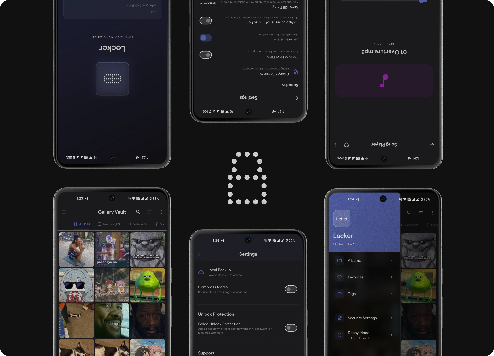

# Latch

<p align="center">
  
</p>

<p align="center">
  <a href="https://play.google.com/store/apps/details?id=com.mossapps.locker">
    
  </a>
</p>

---

Latch is a private vault for Android, written in Flutter. It hides photos,
videos, audio, documents, notes, and passwords behind PIN/password/biometric
authentication. **Hiding is the default; file encryption is an explicit
opt-in**, globally or per file. Session locking and optional background
auto-kill control what happens when you leave the app.

> On Google Play: [Download Latch](https://play.google.com/store/apps/details?id=com.mossapps.locker).

## Features

**Vault**
- Import from gallery, camera, or files; optionally delete the originals
- Share file attachments to Latch from other Android apps (sources stay intact)
- Duplicate detection on import
- Per-file encryption settings and compression
- Local ZIP backup/restore, desktop backup/restore, and manual WebDAV sync
- Recently Deleted: local recovery for 30 days by default; choose 7/30/90 days
  or immediate deletion, restore before expiry, or explicitly delete permanently

**Organization**
- Nested folders with drag-and-drop, breadcrumbs, and a tree view
- Albums, color-coded tags, favorites
- Grid/list explorer with filters, multi-select, sorting (date, name, size, type)
- Search across name, tags, type, and date
- Saved smart collections, including Untagged, Unencrypted, and Large Videos
- Customizable bottom navigation with scrolling labels at narrow widths or large text sizes

**Notes and passwords**
- Plain-text and Markdown notes, with encryption choices and dedicated editors
- Password entries with a dedicated editor and Android Autofill integration
- To fill stored logins in other apps, choose **Latch** as the Android Autofill
  service in system settings (usually Passwords & accounts → Autofill service)
- Separately, optional **Autofill Credential** in Latch Security settings lets an
  external password manager fill the *vault unlock* field; it is off by default
  and is not the same feature as filling stored logins

**Viewing**
- Image viewer (pinch-zoom, slideshow)
- Video player (speed, loop)
- Song player with Flick handoff
- PDF and Office document viewer
- Export to Downloads or external apps

**Security**
- PIN or password unlock, with biometrics
- AES-256-GCM (default algorithm when encryption is enabled) or AES-256-CTR,
  with re-encryption of existing files; explicit per-file choices override the global default
- Argon2id master-key wrapping; per-file PBKDF2
- Inactivity/background session locking, Lock now, configurable auto-kill and screenshot protection
- Best-effort secure deletion when permanently removing vault bytes or source files;
  this does not guarantee erasure from flash storage
- Decoy vault behind a separate PIN

**Theme**
- Accent colors, custom theming, glassmorphism unlock screen

## Recovery and backups

Open **Recently Deleted** from the vault drawer or Settings → Storage. Deleted
items leave active lists, search, and password Autofill but still consume local
storage, including thumbnails. Retention changes affect future deletions only.
Expiry cleanup runs while unlocked and on the next unlock/resume, not as a
guaranteed OS background job. New ZIP and desktop backups exclude trash.

Deletion records a WebDAV tombstone locally for the next sync; restoring makes
the item eligible to sync again. Permanent deletion/expiry removes local bytes,
**not existing backups or retained remote blobs**. See the
[recovery policy](docs/recently_deleted.md) for interrupted-operation handling,
storage accounting, and sync conflicts. Keep an external backup: uninstalling or
clearing app data removes the local vault and Recently Deleted.

## WebDAV sync

Settings → Storage → **Server Sync** connects the main vault to a user-chosen
WebDAV server in push-only backup or two-way mode. Sync is manual, streams file
transfers, reports byte progress, supports cancellation, and asks for review when
versions conflict. The server must support the tested publication guards; unsafe
servers are rejected rather than silently risking an overwrite.

The manifest is encrypted, but **payloads are uploaded as stored**: hidden-only
files remain unencrypted on the server. Enable file encryption if that is not
acceptable. Prefer HTTPS; HTTP requires an explicit warning and is unsuitable
for untrusted networks. WebDAV does not upload the vault master key, so a fresh
device needs key continuity via desktop restore and the original vault credential.
Album/folder definitions and smart-collection definitions do not sync. Details:
[WebDAV design and recovery limits](docs/local_server_sync.md).

## Moss Ecosystem

Latch is part of the Moss ecosystem. **Flick** is the companion music
player (UAC 2.0 DAC support). Latch can hand audio playback to Flick and
return via `locker://return`. Details in the
[Flick Integration Guide](docs/flick_integration.md).

## Desktop Backup (Latch Web)

`latchd` is a tiny companion you run on your desktop. It hosts a local
web UI (`http://127.0.0.1:7800`, loopback only), shows a pairing QR, and
receives vault backups from the phone over Wi-Fi or USB without a hosted
account. The manifest/key bundle is encrypted; file payloads keep their existing
encryption state, so hidden-only files are **not** made encrypted by backup.
The pairing receiver uses token-gated HTTP, not TLS: use a trusted LAN or USB,
especially for unencrypted files. It can also browse, verify, restore, and
export-decrypt a backup.

### Installation

**Linux** (amd64 / arm64) — one-line installer, installs to
`~/.local/bin/latchd` with sha256 verification:

```bash
curl -fsSL https://raw.githubusercontent.com/moss-apps/Latch/HEAD/scripts/install-latchd.sh | bash
```

Installer overrides (environment variables): `LATCHD_BINDIR` (install
directory), `LATCHD_VERSION` (pin a release tag, e.g. `0.19.1-beta.1`),
`LATCHD_REPO` (alternative fork).

**Windows** — download `latchd-windows-amd64.exe` from
[releases](https://github.com/moss-apps/Latch/releases).

**From source** — needs Go 1.26+ and Make; no repo clone required for the installer
paths above:

```bash
make latchd          # builds ./latchd/latchd
```

macOS is not supported yet (prebuilt binaries are Linux/Windows only).

### Configuration

`latchd` needs no config file. Subcommands and their options:

| Command | Purpose | Options |
|---------|---------|---------|
| `latchd serve` | Loopback web UI: pairing QR, browse, restore | `--addr 127.0.0.1:7800` (listen address), `--dir latch-backup` (backup directory) |
| `latchd verify` | Verify a local backup against its manifest | `--dir latch-backup`, `--password` |
| `latchd export-decrypted` | Decrypt a local backup to plaintext | `--out <dir>` (required), `--dir latch-backup`, `--password` |
| `latchd version` | Print the build version | — |

The vault password comes from `--password`, the `LATCHD_PASSWORD`
environment variable, or an interactive prompt. It is never stored and
kept in memory only — prefer the prompt or env var over the flag.

Network defaults:

- **Web UI:** `127.0.0.1:7800`, loopback only — never exposed to the LAN.
- **Pairing receiver:** `0.0.0.0:7801` (fixed port so one firewall rule
  covers every session; falls back to an ephemeral port if taken). It
  exists only while a pairing session is active and is token-gated. On
  Linux/ufw, latchd prints the exact rule at session start, e.g.
  `sudo ufw allow from <lan-subnet> to any port 7801 proto tcp`.
- **USB:** `adb reverse tcp:<port> tcp:<port>` (shown in the web UI),
  then tap Connect via USB on the phone and Allow once on the desktop.

### Quick start

1. Run `latchd serve` and open <http://127.0.0.1:7800>
2. Start a pairing session (if your firewall asks, latchd prints the exact rule)
3. Phone: Latch → Settings → Storage → Desktop Backup → scan the QR

Full spec: [docs/desktop_backup.md](docs/desktop_backup.md).

## Technology Stack

**Flutter**

| Package | Purpose |
|---------|---------|
| `flutter_riverpod` | State management |
| `flutter_secure_storage` | Credentials and metadata |
| `pointycastle` | AES-256 encryption |
| `photo_manager` | Gallery access and import |
| `pdfrx` | Native PDF rendering |
| `syncfusion_flutter_pdf` | Office document conversion |
| `flutter_image_compress` | Image compression |
| `video_compress` | Video compression |
| `archive` | ZIP/RAR/7Z support |
| `permission_handler` | Runtime permissions |
| `local_auth` | Biometric authentication |
| `camera` | Photo/video capture |
| `just_audio` | Audio playback |
| `in_app_update` | Play Store updates |

**Kotlin / Android**

| Component | Purpose |
|-----------|---------|
| `MainActivity.kt` | Auto-kill, performance settings, content URI handling |
| `AutoKillService` | Removes app from recents when backgrounded |
| `PermissionHandler` | Runtime permission management |

## Getting Started

**Android app prerequisites**

- Flutter **3.47.2 stable** (the CI version; bundled Dart 3.13.2). The
  `pubspec.yaml` Dart constraint is `>=3.4.4 <4.0.0`, not a Flutter version requirement.
- JDK 17 and the Android SDK/NDK required by that Flutter toolchain; compile/target
  SDK and NDK versions come from Flutter's Gradle configuration.
- Android 8.0 (API 26)+ device/emulator. The bundled PocketBase sidecar build
  currently targets **arm64-v8a**; rebuilding it needs **Go 1.27+** and Make
  (`pocketbase/go.mod`). `make pb-linux` is available for host-side development.
- For release signing, configure your own untracked `android/key.properties`
  and keystore; never commit signing secrets or private symbol files.

```bash
flutter pub get
make pb                                      # rebuild ARM64 sidecar when needed
flutter run                                  # debug
flutter run -d <device-id>                   # specific device
flutter build apk --release --obfuscate --split-debug-info=./build/symbols
flutter pub run flutter_launcher_icons       # regenerate icons (optional)
```

Checks: `dart format --output=none --set-exit-if-changed lib test`,
`flutter analyze --no-pub`, and `flutter test --no-pub`. Building `latchd` is
separate from the Android app and needs Go 1.26+; Node is only needed to rebuild
its web assets with `make latchd-web`, not to use the committed embedded assets.

## Permissions

| Permission | Purpose |
|------------|---------|
| READ_EXTERNAL_STORAGE / WRITE_EXTERNAL_STORAGE | File access (Android ≤12) |
| READ_MEDIA_IMAGES / READ_MEDIA_VIDEO | Media access (Android 13+) |
| MANAGE_EXTERNAL_STORAGE | Full file access for hide/unhide (Android 11+) |
| CAMERA | Capture photos and videos |
| RECORD_AUDIO | Audio with video |
| USE_BIOMETRIC | Biometric authentication |

## Architecture

Service-based, split into four layers: **Services** (auth, encryption,
file ops, media), **Providers** (Riverpod reactive state), **Screens**
(feature UI), and a **Kotlin backend** (auto-kill, permissions, camera).
Credentials/key wraps and recovery metadata use `flutter_secure_storage`
backed by Android platform security. Payload encryption follows the file's
chosen policy. Gallery picker coordination, drawer, thumbnails, and filtering
are separate components/services rather than one screen. See
[Media Encryption & Compression](docs/architecture_media.md).

## Documentation

- [Media Encryption & Compression](docs/architecture_media.md): compression, encryption, file ops
- [Unlock Autofill](docs/unlock_autofill.md): unlock credential autofill and its security model
- [WebDAV Sync](docs/local_server_sync.md): setup model, server requirements, conflicts, and key continuity
- [Recently Deleted](docs/recently_deleted.md): retention, permanent deletion, backup, and sync policy
- [Phase 5 Device Checks](docs/phase5_testing.md): recovery, accessibility, and gallery regression checklist
- [Flick Integration Guide](docs/flick_integration.md): Flick playback handoff contract

## Contributing

See [CONTRIBUTING.md](CONTRIBUTING.md) for setup, checks, and invariants.
Security issues go through [SECURITY.md](SECURITY.md) — never a public issue.

## License

MIT, see [LICENSE](LICENSE). Free, no ads, no paid features.

## Contributors
  
- [@ultraelectronica](https://github.com/ultraelectronica) (creator)

## Transparency

I build this with [OpenCode](https://opencode.ai). It writes some of the
comments and docs, and it's bailed me out of more than a few nasty-ass bugs.
The code, the design calls, and the fuck-ups are all mine.
