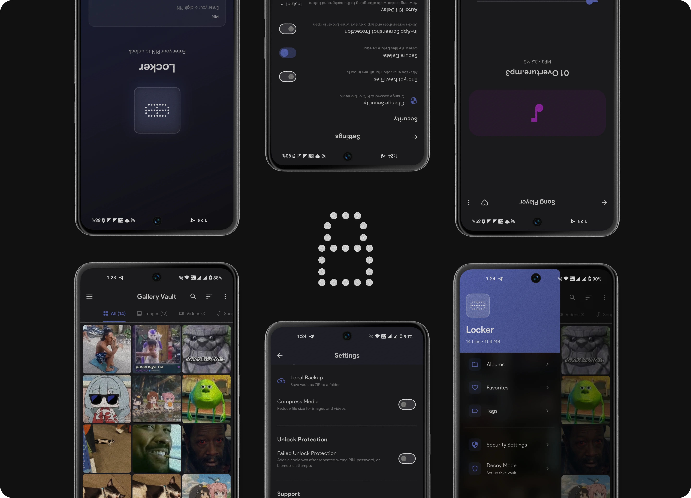

# Latch

<p align="center">
  
</p>

<p align="center">
  <a href="https://play.google.com/store/apps/details?id=com.mossapps.locker">
    
  </a>
</p>

---

Latch is a private vault for Android. It keeps photos, videos, audio, documents,
notes, and passwords behind a PIN, password, or biometric unlock. Hiding is the
default. **Encrypting files is opt-in**, either globally or per file. Session
locking and optional background auto-kill decide what happens when you leave
the app.

> [Download Latch on Google Play](https://play.google.com/store/apps/details?id=com.mossapps.locker).

## What it does

**Vault**
- Import from the gallery, camera, or files, and optionally delete the originals
- Share files to Latch from other Android apps; the source stays where it is
- Catch duplicate imports
- Choose per-file encryption and compression
- Back up locally as a ZIP, back up to a desktop, or sync with WebDAV
- Recover deleted items for 30 days by default (7, 30, or 90 days, or delete
  immediately), and restore them before the deadline

**Organizing**
- Nested folders with drag-and-drop, breadcrumbs, and a tree view
- Albums, color-coded tags, and favorites
- Grid or list view with filters, multi-select, and sorting by date, name, size,
  or type
- Search by name, tag, type, or date
- Saved smart collections such as Untagged, Unencrypted, and Large Videos
- Customizable bottom navigation that still works at narrow widths and large
  text sizes

**Notes and passwords**
- Plain-text and Markdown notes with their own editors and encryption choices
- Password entries with a dedicated editor and Android Autofill support
- To fill saved logins in other apps, pick **Latch** as Android's Autofill
  service (usually Passwords & accounts → Autofill service)
- Separately, the optional **Autofill Credential** setting lets an external
  password manager fill the *vault unlock* field. It's off by default and is not
  the same thing as filling stored logins

**Viewing**
- Image viewer with pinch-zoom and slideshow
- Video player with speed and loop controls
- Song player with Flick handoff
- PDF and Office document viewer
- Export to Downloads or another app

**Security**
- PIN or password unlock, plus biometrics
- AES-256-GCM by default when encryption is on, or AES-256-CTR; changing the
  algorithm re-encrypts existing files, and per-file choices override the global
  default
- Argon2id wraps the master key; each file gets a PBKDF2-derived key
- Session locking on inactivity or background, Lock now, optional auto-kill, and
  screenshot protection
- Best-effort secure deletion when you permanently remove files; this is not a
  guarantee that flash storage is wiped
- A decoy vault behind a separate PIN

**Theme**
- Accent colors, custom themes, and a glassmorphism unlock screen

## Recently Deleted and backups

Open **Recently Deleted** from the vault drawer or Settings → Storage. Deleted
items disappear from lists, search, and password Autofill, but they still take
up space, including thumbnails. Changing retention only affects future
deletions. Cleanup runs while the vault is unlocked and again on unlock or
resume; it is not a guaranteed background job. New ZIP and desktop backups skip
the trash.

A local delete records a WebDAV tombstone for the next sync. Restoring the item
makes it eligible to sync again. Permanent deletion and expiry remove local
bytes, but they do **not** touch existing backups or remote blobs that were
already retained. The [recovery policy](docs/recently_deleted.md) covers
interrupted operations, storage accounting, and sync conflicts. Keep an
external backup: uninstalling or clearing app data removes the vault and its
trash.

## WebDAV sync

Settings → Storage → **Server Sync** connects the main vault to a WebDAV server
you choose. You can run push-only backups or two-way sync. Sync is manual, streams
files, reports byte progress, supports cancellation, and asks you to review
conflicts instead of picking a winner for you. The server has to pass Latch's
publication checks; an unsafe server is rejected rather than risking an
overwrite.

The manifest is encrypted, but **payloads are uploaded as stored**: hidden-only
files stay unencrypted on the server. Turn on file encryption if that's not okay.
Use HTTPS. Plain HTTP needs an explicit warning and is a bad idea on an
untrusted network. WebDAV never uploads the vault master key, so a fresh device
needs key continuity from a desktop restore plus the original vault credential.
Album, folder, and smart-collection definitions don't sync. More:
[WebDAV design and recovery limits](docs/local_server_sync.md).

## Flick

Latch can hand audio playback to **Flick**, the companion music player with UAC
2.0 DAC support. Flick returns via `locker://return`. See the
[Flick integration guide](docs/flick_integration.md).

## Desktop backup (latchd)

`latchd` is a small Go program you run on a desktop or laptop. It serves a local
web UI at `http://127.0.0.1:7800`, shows a pairing QR, and receives vault backups
from your phone over Wi-Fi or USB. No account, no hosted service. The manifest
and key bundle are encrypted. File payloads keep their existing state, so
hidden-only files are **not** encrypted by the backup. The pairing receiver uses
token-gated HTTP, not TLS, so use a trusted LAN or USB, especially if some files
are unencrypted. You can also browse, verify, restore, and export decrypted
files from a backup.

### Installation

**Linux** (amd64 / arm64): the one-line installer puts `latchd` in
`~/.local/bin` and checks the SHA-256:

```bash
curl -fsSL https://raw.githubusercontent.com/moss-apps/Latch/HEAD/scripts/install-latchd.sh | bash
```

Installer overrides: `LATCHD_BINDIR` (install directory), `LATCHD_VERSION` (pin
a release tag, e.g. `0.19.1-beta.2`), and `LATCHD_REPO` (use a fork).

**Windows**: download `latchd-windows-amd64.exe` from
[releases](https://github.com/moss-apps/Latch/releases).

**From source**: needs Go 1.26+ and Make.

```bash
make latchd          # builds ./latchd/latchd
```

macOS isn't supported yet. Prebuilt binaries are Linux and Windows only.

### Configuration

`latchd` doesn't need a config file. Commands and options:

| Command | What it does | Options |
|---------|--------------|---------|
| `latchd serve` | Loopback web UI: pairing QR, browse, restore | `--addr 127.0.0.1:7800` (listen address), `--dir latch-backup` (backup directory) |
| `latchd verify` | Check a local backup against its manifest | `--dir latch-backup`, `--password` |
| `latchd export-decrypted` | Decrypt a local backup to plaintext | `--out <dir>` (required), `--dir latch-backup`, `--password` |
| `latchd version` | Print the build version | — |

The vault password can come from `--password`, the `LATCHD_PASSWORD`
environment variable, or an interactive prompt. It's never stored and only
lives in memory. Prefer the prompt or the environment variable over the flag.

Network defaults:

- **Web UI:** `127.0.0.1:7800`, loopback only, never exposed to the LAN.
- **Pairing receiver:** `0.0.0.0:7801` (a fixed port so one firewall rule covers
  every session; it falls back to an ephemeral port if 7801 is taken). It only
  exists while a pairing session is active and is token-gated. On Linux/ufw,
  latchd prints the exact rule when the session starts, for example
  `sudo ufw allow from <lan-subnet> to any port 7801 proto tcp`.
- **USB:** `adb reverse tcp:<port> tcp:<port>` (shown in the web UI). Then tap
  Connect via USB on the phone and Allow once on the desktop.

### Quick start

1. Run `latchd serve` and open <http://127.0.0.1:7800>.
2. Start a pairing session. If your firewall asks, latchd prints the exact rule.
3. On the phone: Latch → Settings → Storage → Desktop Backup → scan the QR.

Full details: [docs/desktop_backup.md](docs/desktop_backup.md).

## Tech stack

**Flutter packages**

| Package | What it's for |
|---------|---------------|
| `flutter_riverpod` | State management |
| `flutter_secure_storage` | Credentials and metadata |
| `pointycastle` | AES-256 encryption |
| `photo_manager` | Gallery access and import |
| `pdfrx` | Native PDF rendering |
| `syncfusion_flutter_pdf` | Office document conversion |
| `flutter_image_compress` | Image compression |
| `video_compress` | Video compression |
| `archive` | ZIP/RAR/7Z support |
| `permission_handler` | Runtime permissions |
| `local_auth` | Biometric authentication |
| `camera` | Photo/video capture |
| `just_audio` | Audio playback |
| `in_app_update` | Play Store updates |

**Kotlin / Android**

| Component | What it's for |
|-----------|---------------|
| `MainActivity.kt` | Auto-kill, performance settings, content URI handling |
| `AutoKillService` | Removes the app from recents when backgrounded |
| `PermissionHandler` | Runtime permission management |

## Getting started

**Android app prerequisites**

- Flutter **3.47.2 stable** (the CI version, bundled Dart 3.13.2). The
  `pubspec.yaml` Dart constraint is `>=3.4.4 <4.0.0`; that's a Dart constraint,
  not a Flutter version requirement.
- JDK 17 and the Android SDK/NDK that Flutter expects; compile/target SDK and
  NDK versions come from Flutter's Gradle configuration.
- Android 8.0 (API 26)+ device or emulator. The bundled PocketBase sidecar
  currently builds for **arm64-v8a** only. Rebuilding it needs **Go 1.27+**,
  Python 3, and Make (`pocketbase/go.mod`). `make pb-linux` is there for
  host-side development.
- For release signing, set up your own untracked `android/key.properties` and
  keystore. Never commit signing secrets or private symbol files.

```bash
flutter pub get --enforce-lockfile
make pb                                      # fresh, fingerprinted ARM64 sidecar
make pb-verify                               # reads the artifact; never runs it
make android-release-aab                     # build + verify only; does NOT install
flutter pub run flutter_launcher_icons       # regenerate icons (optional)
```

Release builds fail if the PocketBase sidecar is missing or stale. Python 3 and
Go are required for that read-only build check. To check an existing APK/AAB,
run `python3 scripts/pocketbase_artifact.py verify <artifact-path>`.
Don't use `flutter run`, install, uninstall, or clear app data on a live-vault
device as a release test. Follow the approval and isolation steps in the
[stable release checklist](docs/stable_release_checklist.md). A successful build
is not hardware acceptance or permission to publish.

Checks: `dart format --output=none --set-exit-if-changed lib test`,
`flutter analyze --no-pub`, and `flutter test --no-pub`. Building `latchd` is
separate and needs Go 1.26+. Node is only needed to rebuild its web assets with
`make latchd-web`; the committed assets are enough to build and run it.

## Permissions

| Permission | Why |
|------------|-----|
| READ_EXTERNAL_STORAGE / WRITE_EXTERNAL_STORAGE | File access (Android ≤12) |
| READ_MEDIA_IMAGES / READ_MEDIA_VIDEO | Media access (Android 13+) |
| MANAGE_EXTERNAL_STORAGE | Full file access for hide/unhide (Android 11+) |
| CAMERA | Capture photos and videos |
| RECORD_AUDIO | Audio with video |
| USE_BIOMETRIC | Biometric authentication |

## Architecture

The app is service-based and split into four layers: **services** (auth,
encryption, file ops, media), **providers** (Riverpod state), **screens**
(feature UI), and a **Kotlin backend** (auto-kill, permissions, camera).
Credentials, key wraps, and recovery metadata live in `flutter_secure_storage`,
backed by Android platform security. Payload encryption follows each file's
policy. Gallery picker coordination, the drawer, thumbnails, and filtering are
separate components instead of one giant screen. See
[Media encryption & compression](docs/architecture_media.md).

## Documentation

The [documentation index](docs/README.md) lists the current guides and the
archive of completed plans.

- [Media encryption & compression](docs/architecture_media.md): import pipeline, encryption, compression, and file operations
- [Embedded PocketBase](docs/embedded_pocketbase.md): local metadata sidecar, security boundary, and hardware check
- [Desktop backup & restore](docs/desktop_backup.md): latchd pairing, backup layout, restore, and limits
- [Unlock Autofill](docs/unlock_autofill.md): unlock credential autofill and what it gives up
- [WebDAV sync](docs/local_server_sync.md): server requirements, conflicts, and key continuity
- [Recently Deleted](docs/recently_deleted.md): retention, permanent deletion, backups, and sync
- [Device checks](docs/phase5_testing.md): recovery, accessibility, and gallery regression checklist
- [Stable release checklist](docs/stable_release_checklist.md): build checks, isolation, and hardware sign-off
- [Flick integration](docs/flick_integration.md): playback handoff contract

## Contributing

See [CONTRIBUTING.md](CONTRIBUTING.md) for setup, checks, and the rules we don't
bend. Security issues go through [SECURITY.md](SECURITY.md), never a public
issue.

## License

MIT. Free, no ads, no paid features.

## Contributors

- [@ultraelectronica](https://github.com/ultraelectronica) (creator)

## Transparency

I build this with [OpenCode](https://opencode.ai). It writes some of the comments
and docs, and it has bailed me out of more than a few nasty bugs. The code, the
design calls, and the fuck-ups are mine.
